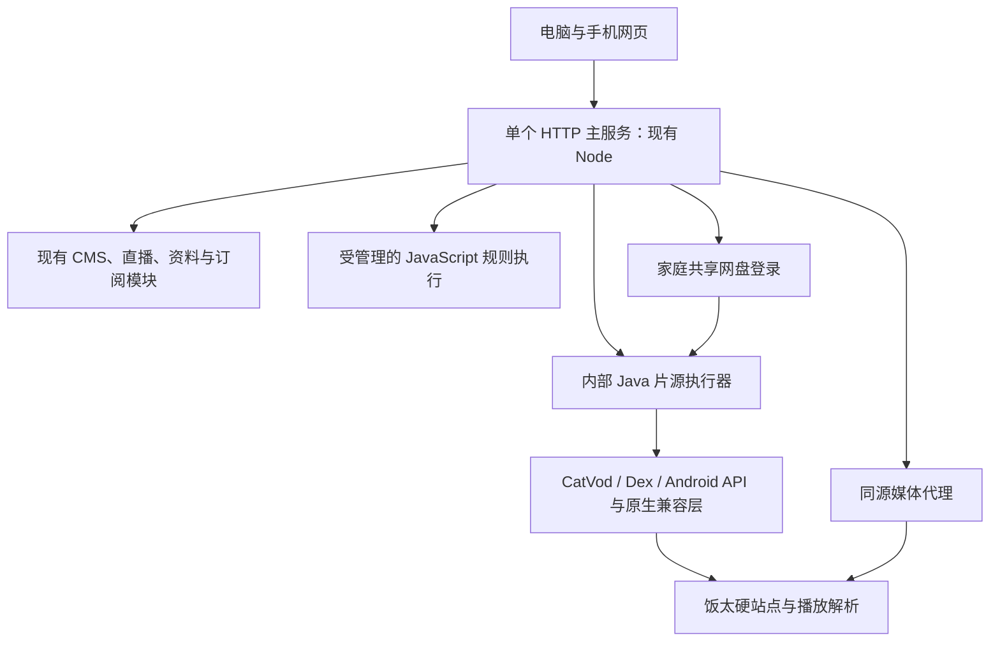

# 饭太硬与网盘兼容：后端方案建议

> 后续决定与实测：用户已纠正 Java 路线；当前采用单个 Node 服务原生适配。光影、奶酪、热播已通过真实网页播放、切集、拖动和续播，见 [实现验收](../development/node-source-compatibility-2026-10-30.md)。下文保留为当时的研究建议，不代表当前实施方向。

日期：2026-10-30。状态：研究建议，未批准迁移、未实现兼容能力。基于当前仓库、公开配置与工件静态检查、候选项目一手源码；本轮未执行第三方 Spider，也未登录网盘或验证真实播放。

## 推荐结论

当前最合适的路径是：保留 React 前端和现有 Node HTTP 主服务，把 Java CatVod/饭太硬兼容执行器作为应用内部受管理的组件；统一打包、启动、停止、日志与版本，不让用户另装或维护 Android、AList 或第二个业务 API 服务。

这是**一个对外应用、内部至少 Node 与 Java 两个执行进程**的方案，不是单进程或纯 Node。用户已拒绝多服务维护，但没有要求单操作系统进程，因此不能替用户把二者混为一谈。最终手机与电脑访问一个原有地址；上游 JavaHost 实际会启动内部回环代理，其中包含随机端口和 9978–9999 范围的插件发现入口，不能直接把该地址交给手机，必须由主服务统一转发。一个对外端口不等于只有一个内部监听；最终映射及回收方式须在验证阶段记录。

Java 全量主后端是合理备选：可以保留前端并迁移现有 API，直接整合 Java 执行器。但它不会比同一个 Java 执行器自动多支持站点，且仍须解决 JavaScript 宿主、媒体代理和网盘会话。建议先验证最重要的片源兼容问题，避免在真实饭太硬尚未跑通前迁移现有稳定能力。

## 需求与判断标准

- 必须实质增加可观看内容；饭太硬为必须验收样本，不能用其他 CMS 片源替换身份。
- 网盘资源、网页登录和实际播放纳入；同一家庭后端保存每平台一份登录，电脑与手机共享。
- 一个部署包、一个启动入口、一个对外端口，统一维护；拒绝需要用户手工启动多个服务的方案。
- 后端语言可重新选择；普通接口可读、媒体地址可取与真实观看必须分别证明。
- 不把 Android 客户端改造成本、网盘接入或浏览器媒体限制藏在“改成 Java”这一句话里。

## 本次直接核实的基线

当前饭太硬订阅有 48 个 type: 3 入口，45 个 csp_ 入口、3 个 JavaScript 入口，另有 6 个直播配置项。并非所有入口都是普通影视站点，也不能将入口数量视为可播放数。见 [订阅静态记录](../development/fantaiying-compatibility-probe-2026-10-30.json)。

当前 Spider 工件 MD5 与订阅声明一致，SHA-256 为 `898e9d7e787c01c2f24ff2457de08533f6b81b165a18103768e1898ba935693c`。它含 Dex 与 ARM/AArch64 ELF 库，依赖 libandroid/liblog 等 Android 库；没有普通 JVM .class 文件。见 [原生依赖记录](../development/fantaiying-native-dependencies-2026-10-30.json)。这解释了直接换 Java 语言为什么不足以解决问题，也为具体兼容层提供了验证对象。

本仓后端非测试 JavaScript 约 1,068 行、9 个文件、11 个 API 路由，主要涉及订阅、CMS、直播、资料增强和上游请求。它尚无大型数据库或独立业务服务依赖，未来迁移 Java 的范围可控；行数仅用于定位迁移面，不构成工期估算。前端已有观看历史与收藏按浏览器 origin 保存，迁移应维持原地址与身份契约，不能让后端语言变化导致记录失效。

## 会改变结论的关键发现

### 有针对饭太硬的非 Android 整机宿主

[jo32/tvbox-silicon](https://github.com/jo32/tvbox-silicon)中的 JavaHost 有 `ProcessHost` 与 `InProcessHost` 调用入口，具备 CatVod 接口、Dex 转换、Android API 适配与饭太硬原生兼容路径。它不是要求用户启动 Android 模拟器的方案；将其提取到本项目仍是工程工作，并非已有稳定 SDK 的直接安装。源码、依赖、许可证和具体局限见 [Java 研究](2026-10-30-java-backend-options.md)。

上游使用 unidbg/Unicorn 等组件处理原生调用；普通 Java 17、Spring Boot 或一个 Dex 转换器均不能替代这些能力。当前工件与上游作者实测工件的版本一致性尚未证明，本轮也未执行，故结论是“找到有针对性的可验证候选”，不是“饭太硬已兼容”。

上游有播放与网盘样本记录，但它们属于作者环境与特定样本，不能计入本项目实测通过数。上游的通用运行库提取仍有未完成工作，需固定研究中的提交与依赖，再进行受控接入。

### 纯 Node 规则路线能扩展，但现有饭太硬覆盖证据弱

[drpy3](https://github.com/hjdhnx/drpy3)可作为 JavaScript 库嵌入，适合验证饭太硬直接引用的规则。它不提供 Guard Dex 执行能力。找到的厂长、立播、瓜子与玩偶规则中，有旧域名、第三方快照、宿主依赖和许可证标注冲突，不能仅凭同名判定同源。具体源码和只读 HTTP 检查见 [Node 研究](2026-10-30-node-source-options.md)。

这条路线适合作为 JavaScript 与个别站点的补充；若用它承担 45 个 CSP 的全部重实现，后续需要持续追踪站点接口和域名变动。当前没有证据支持把这当成满足饭太硬目标的最省成本主路线。

### 网盘能力不由后端语言决定

已找到普通 HTTP 扫码登录、账号状态注入、分享文件解析和媒体代理的实现依据，可迁移到 Node 或 Java。饭太硬某些登录契约比“保存一个 Cookie”更复杂，必须按实际插件/平台验证。源码路径、可复用范围和平台限制见 [网盘研究](2026-10-30-cloud-drive-options.md)。

网盘分享播放可能需要转存；某些候选实现会清理保存目录。正式实现必须限定应用专属目录和文件归属，网页说明操作含义，不能直接照搬删除逻辑或把网盘登录凭据返回给浏览器。网盘会员、上游限速与账号授权范围也不能由更换 Java/Node 消除。

## 方案比较

| 方案 | 饭太硬适配路径 | 部署与维护 | 当前判断 |
| --- | --- | --- | --- |
| 纯 Node + JS/站点重实现 | 原始 3 个 JS 入口可验证；45 个 CSP 需逐站找到等效接口或规则 | 单运行时；站点跟进成本高 | 补充路线，不作为全部目标的主要承诺 |
| Node 主服务 + 内置 Java 执行器 | 尝试复用饭太硬原插件与已有兼容层，JS 保留现有语言环境 | 一个发布包和对外入口；内部多进程需自动管理 | **当前首选验证路线**，改动最聚焦 |
| Java 主后端 + 兼容执行器 + 嵌入 JS | 可使用相同 Java 兼容层；JS 仍需宿主接线 | 可统一 Java 主运行时；既有 API 需迁移 | 长期统一后端的合理备选，不应先于片源验证 |
| Node + 独立 Android/AList 等服务 | 借助完整外部运行环境 | 用户须维护额外运行环境 | 不符合当前部署偏好 |
| Python/Go 主后端 | 可做规则、网盘与代理，但未找到能因此直接覆盖当前 Guard 的证据 | 主语言替换仍需兼容组件 | 当前无优于以上两条主候选的证据 |

Java 可嵌入 GraalJS，但嵌入 Java 的 JS Context 不自带 Node 的 fs/http 等 API，需要重新提供宿主接口；不能认为移植 drpy 引擎就能直接运行全部 Node 站点模块。[Oracle 模块文档](https://github.com/oracle/graaljs/blob/master/docs/user/Modules.md)、[普通 JDK 嵌入说明](https://github.com/oracle/graaljs/blob/master/docs/user/RunOnJDK.md)。

## 推荐结构

用户只操作主应用的启动与停止。Java 执行器使用内部调用协议，不新增面向用户的管理服务；需要的回环代理由应用启动和回收。发生卡死时应能终止并重建执行器，不能把 Java 类加载器或线程取消当成原生代码的硬隔离。图示为建议结构，本轮没有搭建。

## 接入时必须保留的契约

1. 订阅保存影响运行的 spider、站点 jar、ext 与版本信息，不能继续在标准 CMS schema 中丢弃；配置更新不能复用错误的旧执行上下文。
2. 影片详情保留稳定的集数标识；选中集数后再解析媒体地址。带参数或非 HTTP 的播放标识不能提前丢弃，临时签名 URL 也不能用作历史身份。
3. 新播放请求取消旧解析；迟到返回不能覆盖新集数或新站点。跨站仍由用户明确选择。
4. 主服务把媒体统一呈现为浏览器可访问地址：处理请求头、重定向、HLS 主/子清单、分片、密钥、MP4 Range/206、有效期和断开取消。手机不能拿到后端执行器的 127.0.0.1 地址。
5. 账号由后端保存，执行器仅取得当前平台所需状态；浏览器只能取得登录状态和播放结果。退出后撤销对应使用状态，防止继续复用旧会话。
6. 保留现有 API 行为与源身份，迁移或扩展时以接口契约回归现有 CMS、收藏、历史和续播。保持原 origin；原有 71 项测试记录是历史基线，本次没有重跑。

媒体协议需单独验收。当前 Video.js 已包含 HLS/DASH 能力，但应用只放行 m3u8/MP4，增加 DASH 仍需补齐入口与真实媒体测试。[Video.js VHS](https://github.com/videojs/http-streaming)。RTSP、RTMP、磁力、浏览器不支持的音视频编码不会因换语言而自动可播；所需转换/下载能力须按目标样本另行确定，不能写成已经支持。

## 实施前的验证门槛

先完成一个可丢弃的兼容原型，保留当前正式观看入口：

| 检查 | 通过标准 | 未通过时 |
| --- | --- | --- |
| 当前饭太硬工件 | 固定配置与 SHA-256，实际初始化，普通影视站点返回真实分类或搜索、详情、播放解析 | 分清工件版本、Android shim、原生接口或上游问题；不开始大规模 API 迁移 |
| 网页真实点播 | 不少于三个有差异的普通影视站点样本，搜索/详情/首集、另一集与续播均记录证据 | 作为适配问题修复；不能用其他订阅补成通过 |
| 网盘资源 | 一个平台从网页登录到饭太硬分享资源播放，退出、过期与重启状态正确 | 不将“已保存 Cookie”记作完成；继续核对插件账号契约 |
| 单应用部署 | 一个启动入口与对外地址；内部执行器和媒体代理自动启动、停止、回收；执行器失败有错误和恢复入口 | 修正生命周期设计，不交给用户多终端手动维护 |
| 资源与故障 | 记录启动、首播、内存、播放带宽和并发样本；取消和卡死回收有证据 | 按测量决定进程数量、限额和是否适合当前电脑 |

“三个普通站点 + 一个平台”仅为建议的技术选型门槛，不是饭太硬最终交付范围。发布前应对当前 48 个入口逐项标明内容类型、调用能力、实际播放样本、需登录或不支持原因，报告真实覆盖率，不能以原型成功宣称全部站点稳定。

若 Java 兼容原型通过，再实施可发布集成；若失败，报告实际覆盖缺口和修复成本，不静默改成只支持几个 JS 源。之后若决定统一为 Java 主服务，保留 React 构建产物和原 API，迁移 11 个接口及相关边界测试即可，新增片源执行与网盘能力沿用已验证模块。

## 待评审任务拆分

这是任务草案，尚未发布到本地跟踪器。每项以具体观看路径交付，媒体和执行基础按路径提供，避免先建设大量用不到的协议层。

| 编号 | 交付 | 阻塞 |
| --- | --- | --- |
| 01 | 当前饭太硬工件与同一站点的真实兼容原型，输出执行契约与可行性证据 | 无 |
| 02 | 一个启动入口下，从现有网页观看饭太硬普通影视站点并切集、续播 | 01 |
| 03 | 一个实际网盘平台的网页登录、共享状态与饭太硬资源播放；包含必要转存与媒体代理语义 | 01、02 |
| 04 | 饭太硬原始 JS 规则的端到端接入，先从依赖最少的规则验证，再覆盖其余规则的差异 | 02 |
| 05 | 按真实兼容差异拆分其余普通站点与网盘平台任务，每个任务独立演示；不以一个巨型“全站适配”任务覆盖 | 02、03 |
| 06 | 当前订阅全入口覆盖报告、故障恢复、家庭设备实际观看及统一发布验证 | 03、04、05 |

01 完成后再确定具体平台与站点分组，修订 05 的子任务，不能现在凭站点名称预估全部工作量。浏览器与用户网盘操作按实际执行时的授权范围进行；研究阶段没有代用户登录或转存。

## 研究证据与限制

- [Java/JVM 与饭太硬兼容](2026-10-30-java-backend-options.md)
- [Node 规则与代表站点覆盖](2026-10-30-node-source-options.md)
- [网盘登录与媒体交付](2026-10-30-cloud-drive-options.md)
- [当前工件原生依赖](../development/fantaiying-native-dependencies-2026-10-30.json)

已做：仓库调用链检查、真实订阅读取、工件 ZIP/Dex/ELF 静态检查、候选源码/版本/许可证核查、少量无账号 HTTP 抽样。未做：第三方代码执行、候选编译、账号登录/转存、媒体解码、浏览器/真机、性能测试、迁移或发布。

可复用候选涉及 GPLv3、LGPL、MIT 等不同许可证，且部分镜像标注不一致。具体采用范围须按锁定源码保留许可与归属，不能因为都能在 Java/Node 运行就视为同一授权。本报告不将源码存在或作者自测替代本项目实测。
